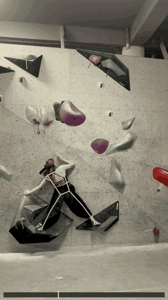
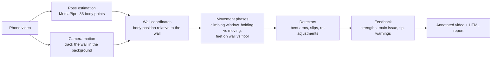

# Boulder Lens

**Video feedback on bouldering technique – from the clip you already film at the gym.**

Climbers film themselves all the time, but rarely learn from the footage. Boulder Lens
takes a normal phone video of a boulder problem, tracks the climber's body and points to
the moments where technique broke down – with one clear thing to work on next.

<p align="center"></p>

> **Status:** working prototype / concept. The detection engine runs on real videos;
> the mobile app is designed but not built yet. See the [roadmap](docs/roadmap.md).

---

## What it does

Input: a video of one attempt (from a tripod *or* filmed by a friend – camera movement is compensated).
Output, for every video:

| File | What it is |
|---|---|
| `*_analysis.mp4` | the video with the skeleton, on-screen messages and a timeline of events |
| `*_report.html` | a one-page report: what went well, the one thing to work on, clickable moments, limits of the analysis |
| `*_report.json` | the same data for an app or for evaluation |

### Detected issues

| Issue | How it is detected | Why it matters |
|---|---|---|
| **Bent arms while holding a position** | the body is still, the hands hang on holds above the shoulders, elbows < 130° for > 1 s | straight arms let the skeleton, not the biceps, carry the weight |
| **Foot slip** | a planted foot drops sharply while the hands stay on the holds | usually caused by not watching the foot onto the hold |
| **Foot re-adjustment** | the same foot is placed twice in a row almost in the same spot | a sign of imprecise footwork ("noisy feet") |

…and two **strengths** it can recognise: straight-arm climbing and precise, quiet feet.

## Design principles

The engine is small on purpose – the interesting part is how feedback is given.

1. **Strengths first.** A report that is only criticism makes people stop filming.
2. **One thing to work on.** Issues are ranked by severity × confidence; the report leads with one tip.
3. **Honest about limits.** If the camera moved, arms were hidden or feet were not visible, the report says so.
4. **Uncertainty is visible.** Every event has a confidence score; uncertain ones are dimmed and labelled.
5. **Context over raw angles.** A bent arm is fine while pulling through a move or locking off – it is only an
   error while *holding a position*. Feet on the mat and the final match on the top hold are not judged.
6. **Built for how people actually film.** None of our test videos were shot on a tripod, so camera motion
   compensation is part of the core, not an extra.

## How it works



All distances are measured in *torso lengths*, so the rules do not depend on how far the camera is from the wall.
Details: [docs/architecture.md](docs/architecture.md).

## Quick start

```bash
python -m venv .venv && source .venv/bin/activate
pip install -r requirements.txt
python scripts/download_model.py          # MediaPipe pose model, ~9 MB
python analyze.py my_climb.mov            # results/ my_climb_analysis.mp4, _report.html, _report.json
python analyze.py videos/*.mov --lang en  # several videos, English feedback
pytest                                    # tests on a synthetic climber, no video needed
```

Tips for filming: whole body in frame, camera roughly level with the middle of the problem,
start a second before leaving the ground.

## Measuring accuracy

Rules are only as good as the evidence behind them. `evaluate.py` compares detections with human labels:

```bash
python evaluate.py template results/ > annotations/labels.json   # pre-filled with detections
# watch the videos, delete false detections, add missed ones
python evaluate.py score results/ annotations/labels.json         # precision / recall per issue
```

## Documentation

- [Architecture](docs/architecture.md) – components, data flow, why each decision was made
- [Lessons learned](docs/lessons-learned.md) – what real videos taught us, v1 → v2
- [Competitive landscape](docs/competitive-landscape.md) – existing apps and where this fits
- [Roadmap](docs/roadmap.md) – from engine to app

## Privacy

Climbing videos show people's faces and bodies. The repository ignores video files by default
(`.gitignore`); do not commit footage of anyone without their consent, and never of children.

## License

MIT
