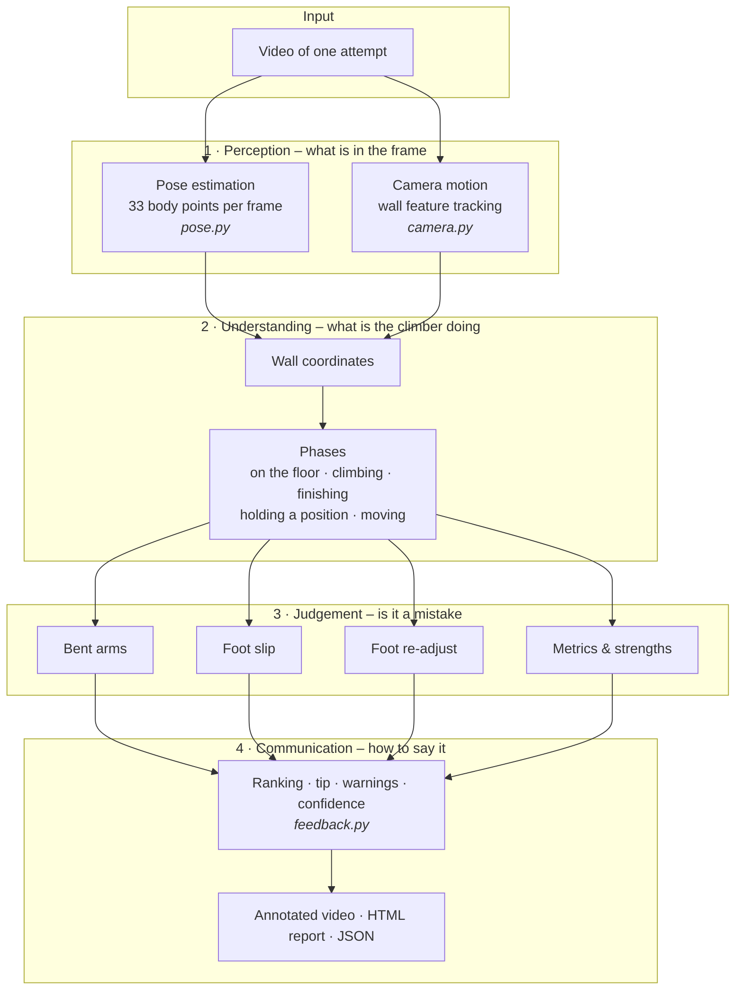
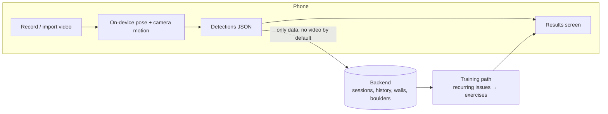

# Architecture

This document explains the system at the level of *decisions*, not code.

## Pipeline

The four layers are deliberately separate. Each can be replaced without touching the others –
e.g. a better pose model (layer 1) or a different tone of voice for beginners (layer 4).

## Key decisions

### 1. Pose estimation on the device's CPU (MediaPipe Pose Landmarker)
- **Why:** free, runs on phones (iOS/Android) as well as on a laptop, 33 points including heels and toes.
- **Trade-off:** 2D only and less accurate for hidden limbs. Depth (how close the hips are to the wall)
  cannot be measured reliably from a single camera behind the climber.
- **Future:** the same model runs on-device, so the app can analyse videos without uploading them.

### 2. Camera motion compensation
- **Why:** in all of our test videos the camera was hand-held and followed the climber.
  Without compensation, a camera pan looks like the climber moving.
- **How:** track points on the wall (with the climber masked out) between frames and chain the
  movements into one coordinate system – the wall.
- **Bonus:** wall coordinates are the basis for linking the video with holds marked on a wall photo (roadmap).

### 3. Everything measured in torso lengths
- Thresholds like "the foot dropped by 0.12" mean 12% of the climber's torso, regardless of zoom,
  distance or the climber's height (works for children too).

### 4. Phase before judgement
The same body position can be correct or wrong depending on the moment
(inspired by *Climbing Technique Evaluation by Means of Skeleton Video Stream Analysis*, Sensors 2023):

| Phase | How it is recognised | Effect |
|---|---|---|
| On the floor / mat | before the first hand goes above the head; feet near the floor level | feet are not judged |
| Holding a position | hips almost still | bent arms are an error |
| Moving | hips moving | bent arms are normal (pulling) |
| Lock-off | one arm bent, the other visibly free | correct technique, no event |
| Finishing | last 2 s of the climb | matching the top hold is not judged |

### 5. Rules, not a trained model (for now)
- **Why:** no labelled dataset exists yet; rules are explainable ("elbow under 130° for over a second"),
  easy to discuss with coaches and to tune.
- **Path to ML:** `evaluate.py` collects human labels. Once there are a few hundred, the rules become
  a baseline to beat with a learned classifier.

### 6. Feedback layer separated from detection
- Ranking: severity × confidence (a slip matters more than a re-adjustment).
- Strengths are computed from the same data (straight-arm ratio, clean foot placements).
- Quality warnings explain *why* the analysis may be incomplete instead of silently failing.
- All texts live in one place (`feedback.py`, Polish & English) so tone can be designed and tested.

## Target app architecture (not built yet)

Privacy by default: the video stays on the phone, only the detections (a few KB) are synced to build
the history and the personal training path. Sharing a video is an explicit choice.

## Code map

| File | Layer | Responsibility |
|---|---|---|
| `boulder_lens/video.py` | – | reads frames identically for every stage |
| `boulder_lens/pose.py` | 1 | MediaPipe pose landmarks |
| `boulder_lens/camera.py` | 1 | camera motion → wall coordinates |
| `boulder_lens/detect.py` | 2–3 | phases, detectors, metrics |
| `boulder_lens/config.py` | 3 | all thresholds in one place |
| `boulder_lens/feedback.py` | 4 | ranking, tips, strengths, warnings, texts |
| `boulder_lens/render.py`, `html_report.py` | 4 | annotated video, HTML report |
| `analyze.py`, `evaluate.py` | – | command line tools |
